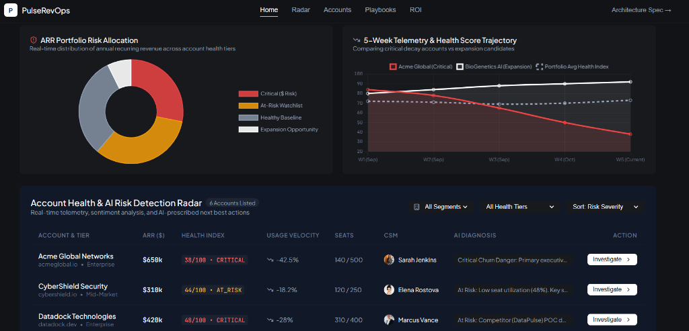

# PulseRevOps AI — Autonomous Churn Prevention & Revenue Health Intelligence


**PulseRevOps AI** is an enterprise-grade, open-source B2B SaaS revenue preservation and account health engine. Built to eliminate surprise churn, it ingests real-time product telemetry (seat usage decay, champion departures, ticket spikes), synthesizes root-cause AI diagnostics, and orchestrates automated CSM retention playbooks.

---

## 📸 Platform Dashboard Preview



*Real-time ARR Portfolio Risk Allocation, 5-Week Telemetry & Health Score Trajectory, and Account Health & AI Risk Detection Radar.*

---

## 🎯 Executive Summary & Engineering Vision

As an **Engineering Leader**, building value-driven AI software requires grounding predictive models and LLMs in core SaaS unit economics—specifically **Net Dollar Retention (NDR)**, **Gross Churn Avoidance**, and **CSM Operational Efficiency**.

PulseRevOps bridges raw product analytics with real-time operational workflows, providing an end-to-end full-stack demonstration of:
- **Telemetry Processing at Scale**: Low-latency ingestion of user activity events and usage decay signals.
- **Hybrid AI Inference**: Rule-based churn risk scoring combined with LLM contextual root-cause synthesis.
- **Actionable CSM Orchestration**: Automated workflow triggers (executive sponsor alerts, discount approvals, health reviews).

---

## 🛠️ Key System Features

### 1. 📊 Proactive Account Risk Radar
* Real-time distribution of Annual Recurring Revenue (ARR) across health tiers: **Critical ($ Risk)**, **At-Risk Watchlist**, **Healthy Baseline**, and **Expansion Opportunity**.
* 5-week historical telemetry trajectory tracking seat decay vs. healthy baseline trends.

### 2. 🧠 Autonomous AI Root-Cause Diagnostics
* Instant AI account investigation drawer detailing root-cause synthesis, contract expiry timelines, and estimated ARR saved prior to renewal negotiations.
* Prompt guardrails enforcing deterministic JSON outputs and PII scrubbing before LLM inference.

### 3. ⚡ CSM Workflow & Playbook Automation
* Trigger-based automated playbooks: Executive Sponsor Introductions, Technical Support Escalations, and Custom Pricing Reviews.

### 4. 📈 Executive ROI & ARR Protection Simulator
* Dynamic financial model calculating annual ARR protected, net retention rate lift, and payback period based on CSM capacity and account volume.

---

## 🏗️ System Architecture

```
                               ┌─────────────────────────────┐
                               │ User Telemetry Ingestion    │
                               │ (Kafka / Snowflake / dbt)   │
                               └──────────────┬──────────────┘
                                              │
                                              ▼
┌─────────────────────────────┐  ┌───────────────────────────┐
│ React 18 + Vite Frontend    │◄─┤ Node.js Telemetry API     │
│ (Dark Mode / Sleek UI)      │  │ (Port 4001 / REST Endpoints)│
└─────────────────────────────┘  └──────────────┬────────────┘
                                                │
                                                ▼
                               ┌─────────────────────────────┐
                               │ Gemini 1.5 Pro AI Synthesis │
                               │ (Contextual Churn Diagnosis)│
                               └─────────────────────────────┘
```

---

## 🚀 Quickstart & Installation

### Prerequisites
- Node.js (v18+)
- npm or yarn

### 1. Clone & Install Dependencies
```bash
git clone https://github.com/AnkushMulkar/pulse-revops-ai.git
cd pulse-revops-ai
npm install
```

### 2. Start Backend API Server
```bash
node server.js
# Backend API running on http://localhost:4001
```

### 3. Start Frontend UI Development Server
```bash
npm run dev
# Frontend UI running on http://localhost:5001
```

---

## 🧪 Production Build & Verification

To verify TypeScript types and build the production bundle:
```bash
npm run build
```

---

## 📜 License & Portfolio Notice

This repository is open-sourced under the **MIT License**. Created as part of an **Engineering Manager Leadership Portfolio** to demonstrate full-stack architecture, product thinking, and business outcome focus.
